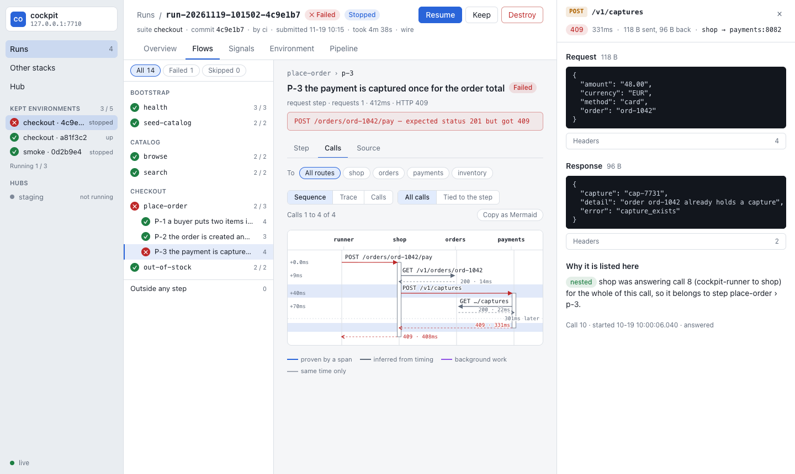

# cockpit

cockpit runs end-to-end flows against a compose stack. You write flows in TypeScript, and the cockpit runner executes them in a container on the stack's network, then writes the results as JSON. One `cockpit` binary carries the runner, so the version you install is the version that runs your flows.

There are two ways to run a suite, and a sealed run works the same on a local hub, in one shot with `cockpit run`, or in GitHub Actions through the [action](docs/hub.md#run-on-github-actions) at this repository's root:

- **On the hub** (`cockpit hub`): one commit and one suite on a fresh sealed environment, with credentials generated inside the run, no route out at runtime unless the commit declares `network: open`, a verdict and a report bundle. [Running on the hub](docs/hub.md) takes a compose project to its first sealed run. A run can also [record its service calls](docs/wire.md) and show, per flow and step, what each server was asked and what it answered as a sequence diagram or a trace.
- **The runner alone**, against a stack you start yourself. It is the quickest way to write and debug flows, and it is what the quick start below sets up. The [usage guide](docs/guide.md) covers it.



The hub's [screen](docs/screen.md) reads a run from its flows down to one call. Here a run stopped at the step that pays for an order: the tree on the left picks the step, the diagram shows the calls its request caused, and the panel on the right holds the request and the response of the call that was refused.

## Install

```sh
brew install --cask d0lim/tap/cockpit
```

or with [mise](https://mise.jdx.dev), globally or pinned per project:

```sh
mise use -g github:d0lim/cockpit
mise use github:d0lim/cockpit@0.7.1
```

Docker is required: `cockpit runner-image` imports the embedded runner as a local image.

## Quick start

Start from a directory with a compose project. This example has one nginx service named `web`:

```yaml
services:
  web:
    image: nginx:alpine
```

Scaffold the suite and run it:

```sh
cockpit init --base-url http://web
export COCKPIT_RUNNER_IMAGE=$(cockpit runner-image)
docker compose -f compose.yaml -f compose.cockpit.yaml up -d web
docker compose -f compose.yaml -f compose.cockpit.yaml run --rm cockpit-runner run smoke
```

```
home › get passed 3ms [200]
missing › get passed 1ms [404]
```

The exit code is 0 when every step passed. `cockpit init` wrote:

| Path | Holds |
| --- | --- |
| `.cockpit/project.yaml` | the project declaration (`hostApi: 1`) |
| `e2e/env.json` | public values for flows; every origin a flow calls must be one of them |
| `e2e/suites/smoke.ts` | a two-flow example suite |
| `e2e/tsconfig.json` | type checking against the declarations in `e2e/.cockpit-sdk` |
| `e2e/.cockpit-sdk/` | the declarations for `cockpit:flow`, `cockpit:collect` and the engine globals, and the tsconfig base |
| `compose.cockpit.yaml` | the runner service and its mounts |
| `.e2e/` | run state and the private env, ignored by git |

`init` refuses to overwrite existing files. Its declaration holds only `hostApi`, which is enough for the runner; the hub needs the rest of the fields in [Running on the hub](docs/hub.md). The [usage guide](docs/guide.md) covers the rest: the mounts and environment, writing flows, the `ctx` ports, running one flow, the output files, exit codes and type checking.

## Type checking

Flows are checked against declarations that cockpit generates and embeds in the binary, so they always match the runner that binary carries. `cockpit init` writes them to `e2e/.cockpit-sdk`, and `cockpit sdk write <dir>` writes them anywhere:

```json
{ "extends": "./.cockpit-sdk/tsconfig.base.json", "include": ["**/*.ts"] }
```

Commit the written files. After upgrading cockpit, write them again and review the diff: it shows every declaration the new version changed, before `tsc` checks the flows against them.

## Reading a run with an agent

`cockpit runs export <id>` writes a run's report bundle to one archive, masked again on the way out, and `cockpit skill write <dir>` writes the skill an agent reads it with. The skill uses `tar`, `jq` and the usual text tools, so the agent needs neither the binary nor the hub. `cockpit runs import <file>` takes an archive back into a hub as a destroyed run, so a run made in GitHub Actions opens on the screen like a local one. The [bundle archive](docs/export.md) page says what the archive holds and what an import checks.

## Releases

A `v*` tag builds the binaries with GoReleaser and attaches them to the GitHub release; mise installs from there. When `sdk/` changed since the previous tag, the release notes carry a "Declarations changed" section with the host API and the diff. The cask in [d0lim/homebrew-tap](https://github.com/d0lim/homebrew-tap) is written by that repository's own workflow from the published release. `hostApi` in `.cockpit/project.yaml` is the compatibility key: the runner refuses a declaration whose host API differs from its own, and a declaration change that breaks scripts written for the current host API raises it.

## Development

```sh
mise install
make verify
```

`make verify` runs vet, `go test -race`, the generated-files diff, the license gate, the no-comment check, the build and the binary size measurement. The rules are in `AGENTS.md`, and the text of the run rules is in `docs/`.

## License

MIT. The full text is in `LICENSE`.
